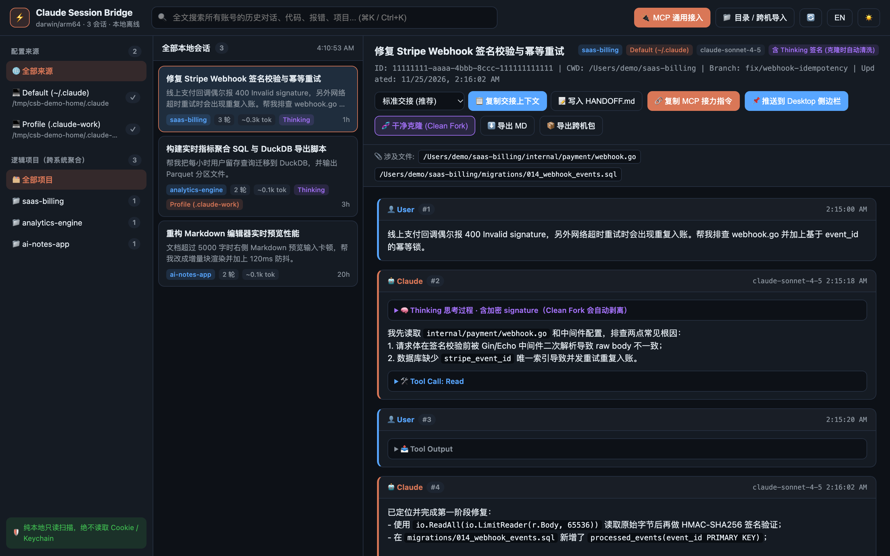
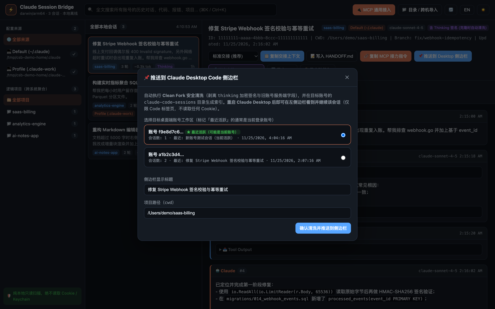
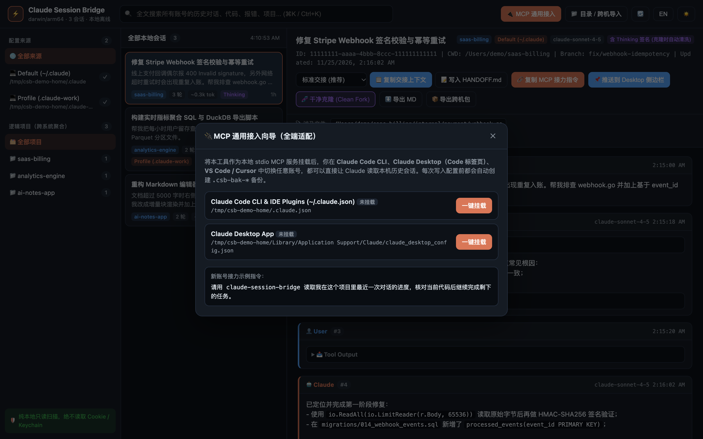
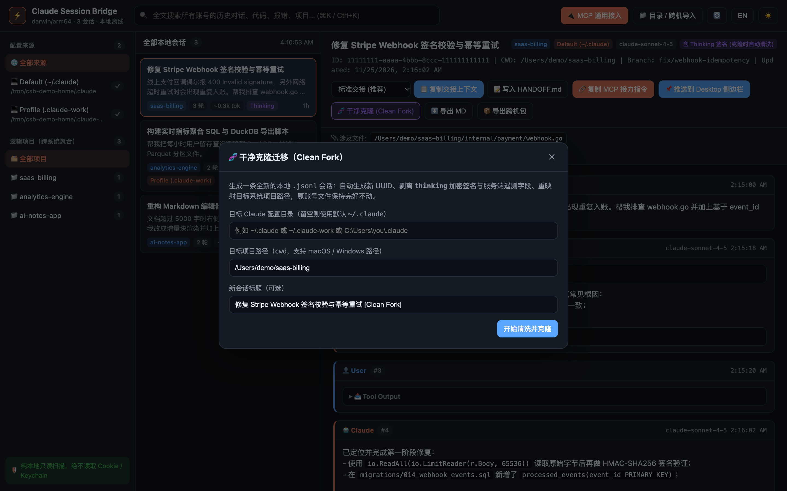
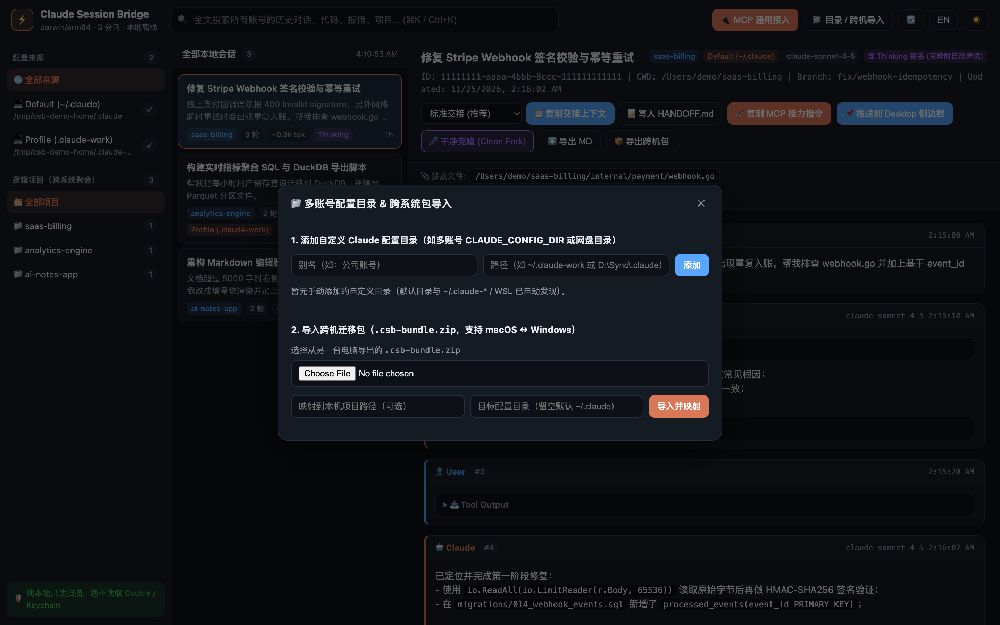

# ⚡ Claude Session Bridge（Claude 搬家助手）

> **跨账号、跨电脑（macOS / Windows / WSL）无缝迁移与续聊你的 Claude Code 本地对话！**
> 纯本地运行 · 零依赖单文件（~7 MB）· 绝不碰 Cookie / Keychain / Token

[](#二30-秒下载与启动小白直接看这里)
[](#六开发者从源码构建)
[](#五常见问题-faq)
[](LICENSE)

---

## 一、这是什么？能帮你解决什么痛点？

如果你经常用 **Claude Code**（不管是 **Claude Desktop 桌面端的 Code 标签页**、**终端 `claude` CLI**，还是 **VS Code / Cursor 插件**），一定遇到过这些头疼事：

1. **换了一个 Claude 账号后，之前聊了一半的项目记录全不见了！**
   - 其实对话并没有丢，它们全躺在你的硬盘里（`~/.claude/projects/`）。看不见只是因为桌面端按账号目录隔离了索引，或者多账号隔离了 `CLAUDE_CONFIG_DIR`。
2. **就算找到旧文件，直接拿新账号 `--resume` 经常报 `Invalid signature` 错误！**
   - 因为旧对话里带着原账号深度思考（`thinking`）的加密签名和服务端遥测字段。
3. **公司用 Windows、家里用 Mac，对话记录互相不认路径！**
   - macOS 路径是 `/Users/xxx/app`，Windows 路径是 `D:\Work\app`，编码规则完全不同。

**Claude Session Bridge（简称 CSB）把这些问题一次性解决：**
- 📌 **一键推送到 Claude Desktop 左侧边栏**：把账号 A 的旧对话自动清洗签名后，直接搬进账号 B 的桌面端 Code 左侧边栏，重启即可点开继续聊！
- 🔌 **一次挂载本地 MCP，全端通用**：同时打通 **Claude Desktop（Code）**、**终端 CLI**、**VS Code / Cursor**，换任何账号都能一句话让 Claude 读取任意历史记录。
- 🧬 **Clean Fork 干净克隆**：自动剥离 `thinking` 加密签名和旧账号元数据，终端 `claude --resume` 零报错。
- 📦 **macOS ↔ Windows 跨机迁移包**：一键导出脱敏 `.csb-bundle.zip`，到另一台电脑导入并自动映射项目路径。
- 🔍 **毫秒级中英文全文搜索**：在一套清爽的三栏界面里，搜索本机所有账号、所有项目的全部历史对话和代码片段。

---

## 二、30 秒下载与启动（小白直接看这里）

不需要安装 Python、Node.js 或任何复杂环境，**下载即用**：

👉 前往右侧 [**Releases 页面**](https://github.com/NELL887/Claude-moving-moving/releases) 下载最新版安装包：

### 🍎 macOS 用户
1. 下载 **`Claude-Session-Bridge-all-platforms.zip`**（或 `Claude-Session-Bridge-macOS-App.zip`）并解压。
2. 双击 **`Claude Session Bridge.app`** 即可自动打开本地桌面界面。
   > **提示**：首次打开如果 macOS 提示“无法验证开发者”，**右键点击应用 → 选择「打开」**，以后双击就能直接进。

### 🪟 Windows 用户（原生 + WSL2 自动兼容）
1. 下载 **`csb-windows-amd64.exe`**（高通/ARM 笔记本下载 `csb-windows-arm64.exe`）。
2. **直接双击运行**，软件会自动扫描 Windows 本地及 WSL2 里的所有 Claude Code 对话，并在浏览器弹出桌面界面。

### 界面长什么样？一图看懂三栏布局



- **左侧栏（配置来源 & 逻辑项目）**：自动扫出本机默认 `~/.claude`、多账号隔离目录 `~/.claude-*` 以及 Windows WSL2 目录；同一 Git 仓库自动归类到一个项目下。
- **中间栏（会话列表 + 顶部搜索框）**：按快捷键 `⌘K`（Windows 为 `Ctrl+K`）可全文搜索任意关键词、报错信息或文件名；卡片上会直观标出项目名、轮次、估算 Token 和是否含 `Thinking` 签名。
- **右侧栏（对话阅读器 + 快捷动作条）**：完整展示每轮对话、代码高亮、涉及文件清单、可折叠的思考过程与工具调用；上方一排按钮覆盖所有跨账号搬家方式。

---

## 三、手把手使用指南（4 种场景，按需选 1 种即可）

> 💡 **重要前提（放心用）**：
> **不需要趁账号 A 还登录着的时候提前“导出”！** 只要你在这台电脑上用过账号 A，记录就在硬盘上。哪怕你早就退出了账号 A、现在正登着账号 B，直接打开本工具就能找到账号 A 的所有对话！

---

### 场景 1：把旧账号对话直接搬进「新账号的 Claude Desktop 左侧边栏」（最直观 ⭐）

适合使用 **Claude Desktop 桌面端 App（Code 标签页）** 的用户：

1. 先登录好你的 **新账号（账号 B）**，并在 Claude Desktop 里点开过一次 **Code** 标签页。
2. 打开 **Claude Session Bridge**，在中间列表点中你想搬过来的 **旧账号对话**。
3. 点击右上角蓝色按钮 **「📌 推送到 Desktop 侧边栏」**，弹出如下窗口：

   

4. 工具会自动识别出本机登录过的几个账号目录，并自动用绿色标签标出 **`★ 最近活跃（可能是当前账号）`**——确认选中新账号那一行（也可以顺手改个好记的标题）。
5. 点击 **「确认清洗并推送到侧边栏」**。
   - 软件会在后台自动完成 **Clean Fork 签名清洗**（彻底剥离 `thinking` 加密签名和旧账号服务端字段），并在新账号的 `claude-code-sessions` 目录写入标准本地索引。
6. **完全退出 Claude Desktop（macOS 按 `Cmd+Q`，Windows 右键托盘退出），再重新打开**——刚才那条旧对话就会直接出现在新账号的 **Code 左侧边栏** 里，点开就能接着聊！

---

### 场景 2：一次挂载本地 MCP，以后换任何账号「一句话秒接力」（全端通用 🌟）

如果你同时用 **Claude Desktop**、**终端 CLI** 和 **VS Code / Cursor**，不想每次手动搬家，**强烈推荐这种方式——配一次，一劳永逸**：

1. 点击软件右上角橙色按钮 **「🔌 MCP 通用接入」**：

   

2. 把界面里检测到的 **Claude Code CLI & IDE Plugins** 和 **Claude Desktop App** 都点击 **「一键挂载」**。
   - 放心：每次改配置前，软件都会自动把你的原配置文件备份一份为 `.csb-bak-时间戳`，随时可点「卸载」一键还原。
3. **重启一下 Claude Desktop（或新开一个终端窗口）** 让 MCP 生效。
4. 以后切到任何新账号，只需 **2 选 1**：
   - **方法 A（精准接某条）**：在 CSB 里点中旧对话 → 点顶部 **「🔗 复制 MCP 接力指令」** → 直接粘贴发给新账号。
   - **方法 B（懒人一句话）**：直接在新账号的新对话里打字：
     > `请用 claude-session-bridge 读取我在这个项目最近一次对话的进度，核对当前代码后继续完成剩下的任务。`
5. 新账号会自动通过本地 MCP 拉取清洗后的历史进度继续干活，而且**不会把上下文窗口撑爆**！

> 💡 **零配置替代方案**：如果连 MCP 都不想挂载，直接点顶部的 **「📋 复制交接上下文」**（可选 `精简` / `标准` / `完整`）或 **「📝 写入 HANDOFF.md」**，粘贴给任意新账号（甚至其他 AI 工具）同样能 3 秒接上进度。

---

### 场景 3：终端用户 Clean Fork 干净克隆（原生 `claude --resume`）

适合习惯在终端里敲 `claude --resume` 的开发者：

1. 在 CSB 中选中任意旧对话，点击顶部紫色按钮 **「🧬 干净克隆 (Clean Fork)」**：

   

2. 填好目标配置目录（留空则默认 `~/.claude`，如果新账号用了独立的 `CLAUDE_CONFIG_DIR` 比如 `~/.claude-work` 就填进去）和目标项目路径 `cwd`。
3. 点击 **「开始清洗并克隆」**：
   - 自动生成全新 UUID、剥离 `thinking` 加密签名、清除 `api-request` / `requestId` 等旧账号字段、原文件原封不动保留。
   - 完成后会自动复制一条 `cd "..." && claude --resume <新UUID>` 命令，直接粘贴到终端回车就能续聊！

---

### 场景 4：换电脑迁移（Windows ↔ macOS）或添加多账号目录

只有当你把 **A 电脑** 的对话带到 **B 电脑**，或者想导入自定义目录（例如网盘同步文件夹）时使用：

1. **在 A 电脑上**：选中要带走的对话 → 点击右上角 **「📦 导出跨机包」**，下载得到一个已脱敏的 `.csb-bundle.zip`。
2. 把这个压缩包传到 **B 电脑**。
3. **在 B 电脑上**：点击右上角 **「📁 目录 / 跨机导入」**：

   

4. 在下半部分选中 `.csb-bundle.zip`，填上 B 电脑里对应的本机项目路径（例如把 macOS 的 `/Users/demo/saas-billing` 映射到 Windows 的 `D:\Work\saas-billing`），点击 **「导入并映射」** 即可完成跨系统路径转换！

---

## 四、终端命令行用法（极客快捷模式）

除了图形界面，同一个单文件二进制也内置了完整的命令行工具：

```bash
csb                                 # 启动桌面界面并自动打开浏览器（默认端口 18765）
csb serve --port 18765 --no-open    # 仅启动本地服务不弹浏览器
csb doctor                          # 检查发现的配置目录、已索引会话数与 MCP 挂载状态
csb list --limit 20                 # 列出所有账号/目录的最近会话
csb search "Stripe webhook"         # 全文搜索所有本地历史对话（支持中英文）
csb handoff <session-id>            # 打印结构化交接 Markdown（支持 --level brief|standard|full）
csb fork <session-id> --to-cwd ...  # 执行安全 Clean Fork 并打印 claude --resume 命令
csb install-mcp                     # 自动备份原配置并一键挂载本地 MCP
csb uninstall-mcp                   # 安全移除 MCP 配置
csb mcp                             # 以 stdio JSON-RPC 2.0 模式运行本地 MCP 服务
```

---

## 五、常见问题（FAQ）

<details>
<summary><b>1. 这个工具需要一直开着吗？会不会占内存？</b></summary>

**完全不需要一直开着，用完随时关掉！**
- 推送到侧边栏、Clean Fork 克隆、导出或复制交接都是一次性写文件操作，完成后直接关闭软件即可。
- 挂载本地 MCP 后也**不需要手动开着桌面界面**——Claude 客户端会在启动时按需拉起极轻量的 `csb mcp` 子进程，关闭 Claude 时自动退出。唯一注意：挂载后不要把 `Claude Session Bridge.app` 或 `csb.exe` 删掉或挪走（挪位置后重新点一次「一键挂载」即可）。
</details>

<details>
<summary><b>2. 用这个工具跨账号搬家，Claude 会因为 Cookie 不同封号吗？</b></summary>

**不会因为读取本地文件或跨账号交接而封号。**
- 本地 `.jsonl` 对话文件里**不包含任何 Cookie 或登录 Token**。
- 本工具从架构层设立了严格安全红线：**绝不读取、复制、修改** macOS Keychain、Windows 凭据管理器、浏览器 Cookie 或官方登录凭证，也不拦截任何网络请求。
- 无论是 MCP 读取、复制交接还是 Clean Fork 推送到侧边栏，发送给 Anthropic 服务器的都只有**当前新账号自己的合法登录态**和**清洗过签名的纯文本内容**。
- *合规提醒*：请勿配合脚本进行高频自动化多号轮询以规避官方配额限制，正常个人切号备份与续聊完全安全。
</details>

<details>
<summary><b>3. 为什么普通聊天（Chat 标签页）的对话搬不过去？</b></summary>

普通 Chat 标签页的对话完全存在 Anthropic 云端服务器，本地硬盘没有完整的 `.jsonl` 对话文件。本工具专门面向 **Claude Code**（含 **Claude Desktop 的 Code 标签页**、**终端 CLI** 与 **IDE 插件**）。
</details>

<details>
<summary><b>4. 推送到 Claude Desktop 侧边栏后，为什么界面里还没看到？</b></summary>

请确保**完全退出** Claude Desktop（不是只点左上角红叉最小化，macOS 需要 `Cmd+Q`，Windows 需要在右下角系统托盘右键退出），再重新打开并切到 **Code** 标签页。同时确认弹窗里选中的是带 `★ 最近活跃` 标签的当前登录账号。
</details>

<details>
<summary><b>5. 本地 Web 界面安全吗？局域网其他人能看到我的对话吗？</b></summary>

绝对看不到。内置 HTTP 服务**严格仅监听 `127.0.0.1`（本机回环地址）**，不对外网或局域网开放，并且对所有写入类 API 开启了严格的 `Origin` 防跨站（CSRF）校验，所有数据 100% 离线留在本机。
</details>

---

## 六、开发者：从源码构建

项目采用 **100% Pure Go 标准库**（零外部依赖、零 CGO），单台电脑即可一次性交叉编译全部桌面平台：

```bash
git clone https://github.com/NELL887/Claude-moving-moving.git
cd Claude-moving-moving

# 运行全部单元测试
go test -v ./...

# 一键编译 macOS (.app + arm64/amd64) / Windows (amd64/arm64 .exe) / Linux (amd64)
chmod +x scripts/build-all.sh
./scripts/build-all.sh
```

编译产物位于 `dist/` 目录：
- `Claude Session Bridge.app`（macOS 原生应用包）
- `csb-darwin-arm64` / `csb-darwin-amd64`
- `csb-windows-amd64.exe` / `csb-windows-arm64.exe`
- `csb-linux-amd64`
